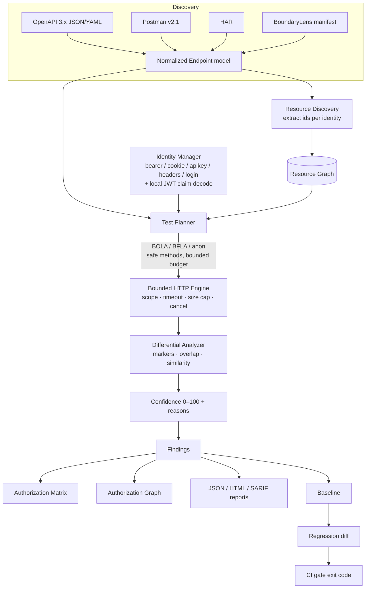

# BoundaryLens architecture

One FastAPI process hosts the scanner, serves the built dashboard, and runs scans as bounded
background `asyncio` tasks. SQLite persists scans and baselines. There are no external services.

## Pipeline

## Modules

| Module | Responsibility |
|--------|----------------|
| `platform/endpoint.py` | Normalized `Endpoint` (method, path, params, security, auth, fields); template normalization; HAR path parameterization; dedup. |
| `platform/discovery/openapi.py` | OpenAPI 3.x / Swagger 2.0 (JSON+YAML) → endpoints, resolving `$ref`, security requirements, response schemas. |
| `platform/discovery/postman.py` | Postman v2.1 → endpoints; `{{var}}` → `{var}`; scripts ignored, not fatal. |
| `platform/discovery/har.py` | HAR → endpoints; API-only filtering; conservative `/{id}` inference only when ≥2 distinct values are seen. |
| `platform/identities.py` | `PlatformIdentity` (bearer/cookie/apikey/headers/login); auth-header builder; signature-free JWT decode; secret handling (env only). |
| `platform/resources.py` | Extract resource ids from JSON (id/typed-id/UUID keys), skip secrets & volatile correlation ids; `ResourceGraph` with per-identity ownership + fingerprints. |
| `platform/planner.py` | Generate owner-baseline + BOLA + BFLA + anonymous test cases; enforce safe methods and a test budget; avoid combinatorial blow-up. |
| `platform/evidence.py` | Differential analysis: reject denial bodies/login pages/401-403; score markers, target id, protected-field overlap, JSON similarity, structure → confidence + reasons. |
| `platform/autoscan.py` | Orchestrate: build identity clients, discover resources, plan, execute (reusing `TargetClient`), analyze, build findings/matrix/graph. |
| `platform/from_manifest.py` | Build an autoscan from the existing manifest + target (dashboard path). |
| `platform/config.py` | `boundarylens.yaml` schema → `AutoScanConfig`; env-var references only; loopback/allowed-host enforcement. |
| `platform/regression.py` | Snapshot a baseline; diff a later scan; classify regressions/fixed/persisting; apply the fail-on threshold. |
| `platform/sarif.py` | SARIF 2.1.0 (confirmed findings only) with CWE/OWASP/confidence and `security-severity`. |
| `cli.py` | `scan` command: load config, discover, run, write reports, gate CI. |

## Reused core (unchanged behavior)

`client.py` (scope-restricted, budgeted `httpx` client with redirect validation and response-size
caps), `redact.py` (secret scrubbing), `normalize.py` (volatile-field-insensitive comparison),
`findings.py` (Finding model, severity, dedup), `storage.py` (SQLite, interrupted-scan recovery),
`manager.py` (background execution, cancellation), `manifest.py`/`engine.py`/`runner.py` (the
original manifest-driven scanner), and `reporting.py` (JSON/HTML).

## Endpoint representation

Every source produces the same `Endpoint`. Downstream code keys on `(method, normalized template)`
and never branches on the source, so adding a source means adding one adapter — not touching the
planner, executor, or analyzer.

## Execution safeguards

All outbound requests go through `TargetClient`: in-scope origin check, per-request timeout,
response-size cap, request budget (shared `ScanContext`), bounded concurrency, redirect validation,
and cooperative cancellation. Mutating methods are filtered out in the planner and re-checked in the
executor (`UNSAFE` cell) so a discovered destructive endpoint is never called by default.

## Persistence

`scans` (with `kind` = manifest|autoscan; result JSON holds findings, matrix, graph, resources,
endpoints, identities, activity) and `baselines`. Interrupted scans are marked failed on restart.
